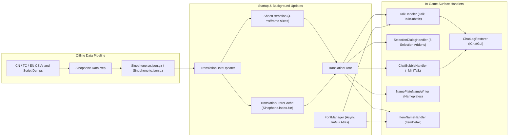
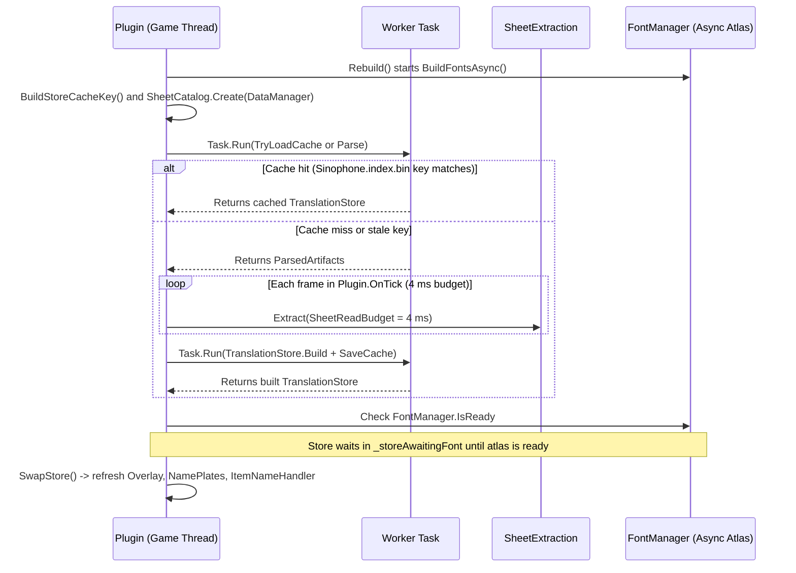
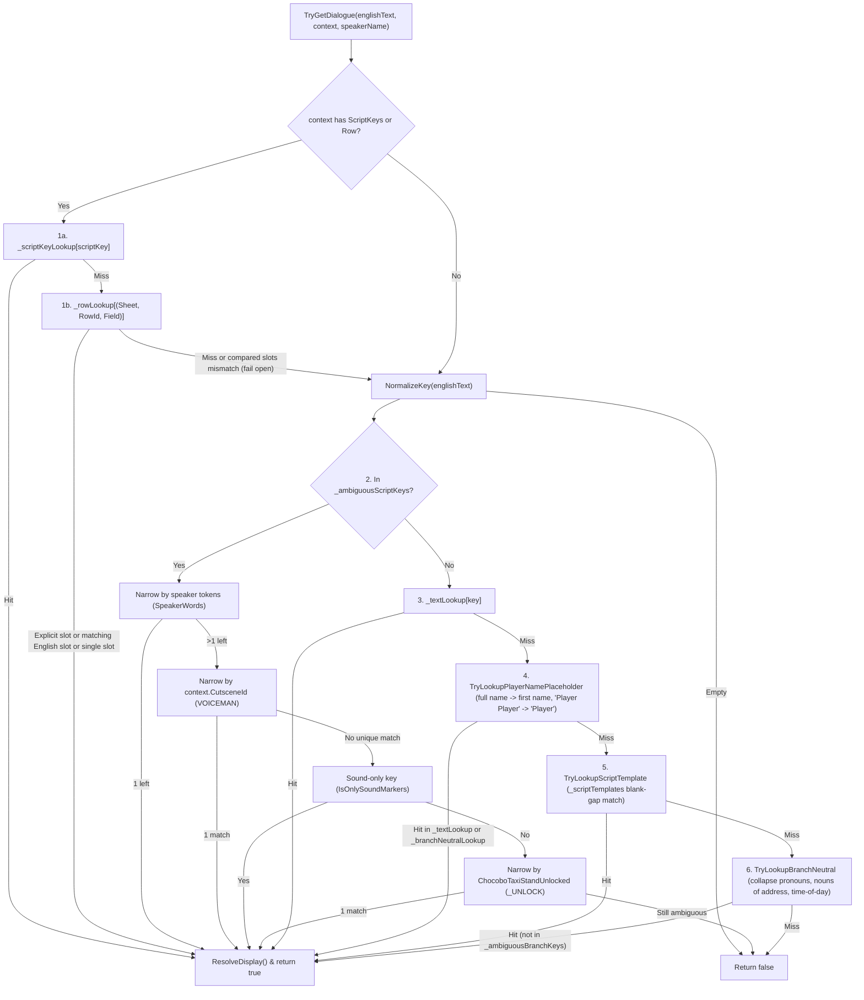
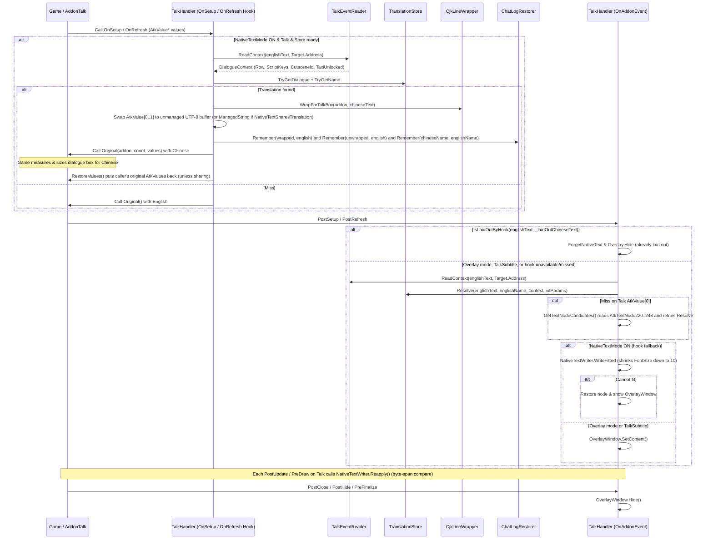
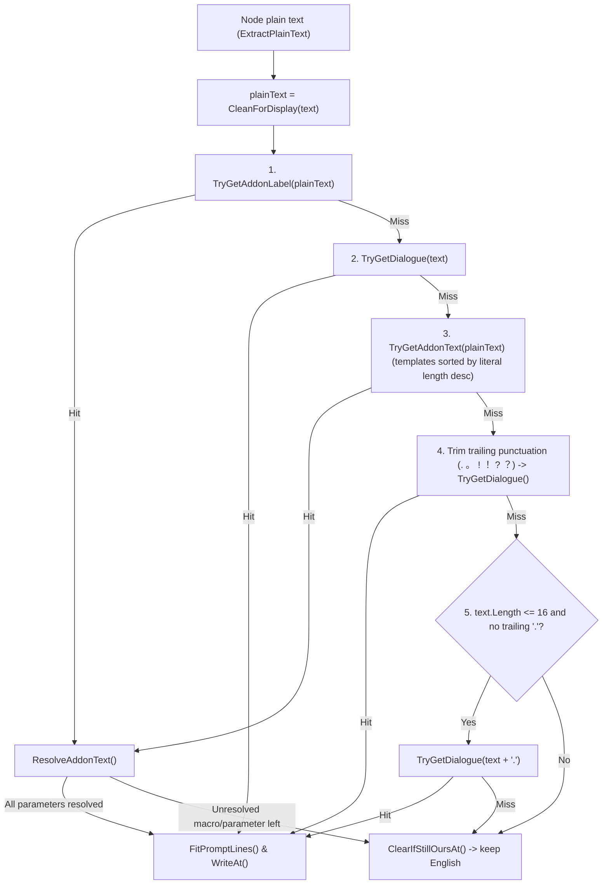
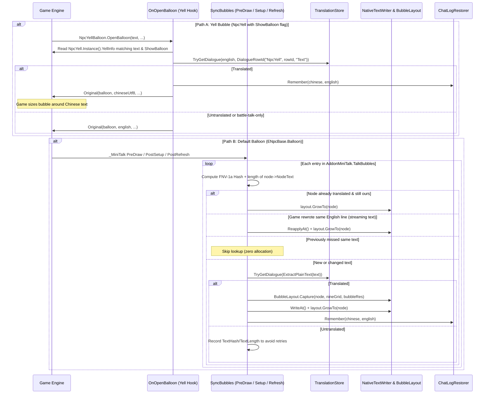
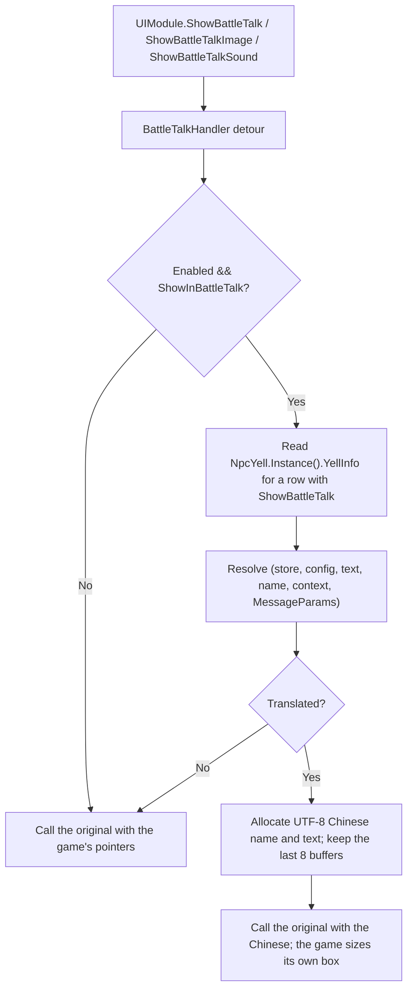
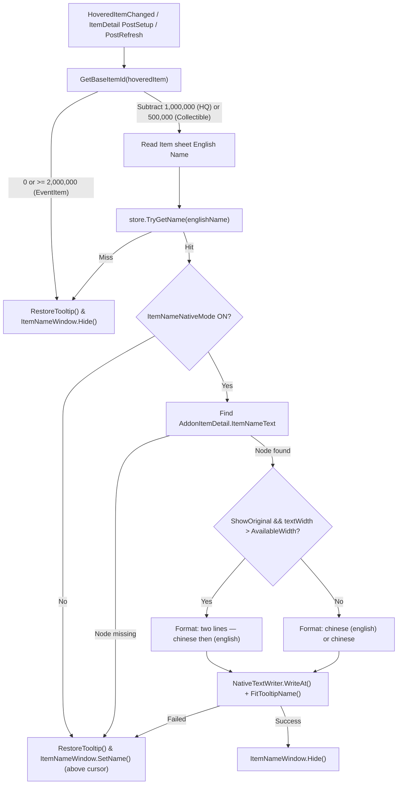

# Translation workflow

This document explains how Sinophone builds translation data, loads and caches it, searches for matches, applies fallbacks, and hooks each in-game dialogue and UI surface.

## End-to-end architecture

Sinophone translates English client text using pre-built CN/TC lookup tables. No external translation API is called at runtime.

### Surface summary

| Component | In-game target | Hook mechanism | Search method | Display output | Fallback behavior |
| --- | --- | --- | --- | --- | --- |
| `TalkHandler` | `Talk`, `TalkSubtitle` | `IAddonLifecycle` + `AddonTalk.VirtualTable` (`OnSetup`, `OnRefresh`) | ID-first (`LuaTexts` / `EventFramework` row), ambiguous script disambiguation, exact text, player placeholder, script template, branch-neutral | `OverlayWindow` (default, and all `TalkSubtitle`) or native `AtkValue` / nodes (`NativeTextMode`) | Text-node segment retry; `NativeTextWriter.WriteFitted` node fallback; `OverlayWindow`; optional English when `HideWhenNoTranslation` is off |
| `SelectionDialogHandler` | `SelectYesno`, `SelectString`, `SelectIconString`, `SelectOk`, `CutSceneSelectString` | `IAddonLifecycle` (`PostSetup`, `PostRefresh`, `PreDraw`, `PostHide`, `PostClose`, `PreFinalize`) | `Addon` label -> dialogue lookup -> `Addon` template -> punctuation trim -> short label `+ "."` | In-place `AtkTextNode` (`NativeTextWriter.WriteAt`) | Unresolved templates or misses leave original English; `FitPromptLines` keeps multi-line layout if single-line exceeds node bounds |
| `ChatBubbleHandler` | `_MiniTalk` (yells & default balloons) | `NpcYellBalloon.OpenBalloon` detour + `IAddonLifecycle` on `_MiniTalk` | Yells: `NpcYell.YellInfo` row ID -> dialogue lookup; Default balloons: plain text -> dialogue lookup | Yells: pre-layout text replacement; Balloons: in-place `BubbleTextNode` + `BubbleLayout.GrowTo` | Misses keep English and are hashed so they are not re-queried every frame; no overlay |
| `BattleTalkHandler` | `UIModule` battle talk (`ShowBattleTalk`, `ShowBattleTalkImage`, `ShowBattleTalkSound`) | Virtual table hook at indices 198, 199, 201 | `NpcYell` row id -> dialogue lookup (id first), otherwise the normalized text; name via `TryGetName` | UTF-8 name and text swapped before the game measures the box | A miss, a disabled setting, or a failed lookup passes the game's own pointers through; no overlay |
| `NamePlateNameWriter` | Visible NPC / object nameplates | `INamePlateGui.OnNamePlateUpdate` | Case-insensitive `TryGetName` (with punctuation trim) | `NamePlateUpdateHandler.NameParts.Text` before game bakes plate | Skips players; misses keep English; no overlay |
| `ItemNameHandler` | Hovered item (`ItemDetail`) | `IGameGui.HoveredItemChanged` + `IAddonLifecycle` on `ItemDetail` | Strips HQ/Collectible offsets -> `Item` sheet English name -> `TryGetName` | `ItemNameWindow` above cursor (default) or `ItemDetail.ItemNameText` (`ItemNameNativeMode`) | Skips `EventItem` (`>= 2,000,000`); missing `ItemNameText` node falls back to `ItemNameWindow` |
| `ChatLogRestorer` | Story tab & yell log lines | `IChatGui.ChatMessage` | Exact match against 64-entry MRU `(Chinese, English)` history | Rewrites `IMutableChatMessage.Message` and `Sender` to English | Unmatched story messages stay as-is and log at debug level |

---

## Data preparation, loading, and caching

### 1. Offline build (`Sinophone.DataPrep`)

`tools/Sinophone.DataPrep` reads datamining CSV dumps and produces gzipped JSON (`TranslationArtifact`, format version 1):

- **Sheets (`Program.cs`)**: Reads named columns (or fixed positional columns for unnamed sheets such as `NpcYell`, `SnipeTalk`, `GimmickTalk`, `Addon`, etc.) into `Sheets[sheetName][rowId][fieldName] = string[]`. Empty slots are kept as empty strings so indices stay aligned with live Lumina sheets.
- **Scripts (`ScriptDump.cs`)**: Reads 14 script folders (`content`, `custom`, `cut_scene`, `dungeon`, `guild_order`, `leve`, `opening`, `quest`, `raid`, `shop`, `story`, `system`, `transport`, `warp`). It pairs localized CN/TC lines with English lines by `TEXT_...` key. In `quest/`, it drops `_SEQ_`, `_TODO_`, and `_QIB_` keys (journal/objectives/unused) while keeping `_SYSTEM_` keys used in dialogue.

### 2. Runtime updates (`TranslationDataUpdater`)

At startup (if `CheckForDataUpdates` is enabled or no data exists and the assembly has no embedded copy), `TranslationDataUpdater`:

1. Fetches `manifest.json` from the `data` GitHub release.
2. Compares `manifest.Version` (a content hash) with `Configuration.LastDataVersion` and per-variant flags (`HasSimplifiedData`, `HasTraditionalData`).
3. Downloads needed `.json.gz` files to `<file>.download`, verifies SHA-256 checksum, gzip decompression, `FormatVersion == 1`, and `Sheets.Count > 0`.
4. Atomically moves valid files into the plugin config directory and sets `_reloadRequested`.
5. `Plugin.OnTick` consumes `_reloadRequested` on the game thread and triggers a background store reload while the existing store keeps serving.

### 3. Startup load & index caching (`Plugin`, `TranslationStore`, `TranslationStoreCache`)

Because Dalamud forbids reading Lumina sheets off the game thread and synchronous CJK font rasterization stalls rendering, startup work is split across worker tasks and frame-budgeted game-thread slices.

- **Cache key (`BuildStoreCacheKey`)**: Combines `Variant`, `UseFallbackVariant`, `Conversion`, `TranslationStore.IndexFormatVersion`, `GetGameDataVersion()`, and `SourceIdentity` (size + UTC ticks for downloaded files, or SHA-256 for embedded resources) for both CN and TC.
- **Variant fallback**: If `UseFallbackVariant` is enabled, `TranslationStore.Build` indexes the primary artifact first and the other variant second (`TryAdd` ensures the primary variant always wins). If a downloaded file fails to parse, `TranslationStore` falls back to `OpenEmbeddedResource`.
- **Eager vs. late display resolution**: During indexing, lines without conditionals or `ObjectParameter` macros are resolved once (`ResolveSheetMacros`, `CleanForDisplay`, `ChineseConverter.Convert`) and stored ready to display. Lines containing `<If(`, `<Switch(`, or `ObjectParameter(` remain raw and are resolved per lookup because their output depends on the active player's gender, Grand Company rank, or character name.

---

## Lookup indices, normalization, and fallbacks (`TranslationStore`)

### Key normalization (`MacroNormalizer.NormalizeKey`)

Before any text lookup or indexing, English strings pass through `NormalizeKey`:

1. **Strip invisible/control characters**: Removes soft hyphens, zero-width spaces/joiners, BOM, replacement chars (`\uFFFD`), and raw SeString control bytes (`U+0002`, etc.); turns non-breaking spaces into spaces.
2. **Replace line breaks**: ` ` and ` ` become `" "` so adjacent words do not glue together.
3. **Strip tags and emphasis**: Removes remaining `<...>` SeString macro tags and `*` / `**` markdown emphasis markers from script dumps. A tag whose contents are all lowercase, such as `<squeal>`, is kept: the dumps write a sound that way and the game draws it as text. Real macros carry a capital, a digit or a slash, so they still go.
4. **Collapse whitespace**: Collapses any run of whitespace (tabs, newlines, multiple spaces) into a single space and trims both ends.

### Dialogue search order (`TranslationStore.TryGetDialogue`)

#### Details of each fallback layer

1. **ID-first lookup (`TryGetDialogueById`)**:
   - **Script keys**: Exact case-insensitive match in `_scriptKeyLookup` using `TEXT_...` keys read from `LuaEventHandler.LuaTexts`.
   - **Sheet rows**: Looks up `(Sheet, RowId, Field)` in `_rowLookup`. If `Slot >= 0`, returns that slot. Otherwise `TrySelectRowSlot` extracts the row's live English variants via `SheetCatalog` and picks the slot whose normalized text matches `englishText`. If the row's English was readable and no slot matched, it **fails open** to text lookup instead of guessing. Only when the live row could not be compared and exactly one translated slot exists does it return that single slot.
2. **Ambiguous script disambiguation (`TryLookupAmbiguousScript`)**:
   - Script lines that share identical English text with different Chinese translations (e.g. `"You bastard!"`) are removed from `_textLookup` and stored in `_ambiguousScriptKeys`.
   - Narrowing runs in four steps:
     1. **Speaker tokens**: Matches normalized speaker words (and full punctuation-free name, e.g. `G'raha Tia` -> `GRAHATIA`) against key tokens (`KeySpeakerTokens`).
     2. **Cutscene ID**: Matches `context.CutsceneId` against `TEXT_VOICEMAN_<id>_...`.
     3. **Sound-only key**: When the key holds nothing but sound markers (`IsOnlySoundMarkers`), answers the first candidate. Every candidate says the same thing, and a balloon that squeals carries no speaker name or id to narrow with.
     4. **Chocobo taxi stand unlock state**: Matches `_UNLOCK` in keys against `context.ChocoboTaxiStandUnlocked` so newly-unlocked vs already-unlocked greetings resolve cleanly.
   - If more than one candidate remains (or none match), lookup returns `false` so the line stays English rather than showing another scene's translation.
3. **Player name placeholder fallback (`TryLookupPlayerNamePlaceholder`)**:
   - Script dumps store `"Player Player"` or `"Player"`, whereas the live game inserts the character's name.
   - Replaces the live `CharacterName` (and, if multi-word, the first name alone) back with `"Player Player"` and then `"Player"`, checking both `_textLookup` and `_branchNeutralLookup`.
4. **Script blank-gap templates (`TryLookupScriptTemplate`)**:
   - Matches `_scriptTemplates`, built from script lines containing runs of 2+ spaces (`ScriptTextTemplate.BuildBlankGapTemplate`) where dynamic values (like item names) are injected at runtime.
5. **Branch-neutral fallback (`TryLookupBranchNeutral`)**:
   - English script dumps resolve conditionals to a single branch. If a player triggers the opposite branch, exact match misses.
   - `CollapseBranchWords` replaces `GenderedPronouns` (`he/him/his/himself/she/her/hers/herself`), `GenderedNouns` (`lad/lass/sir/madam`), and `TimeOfDayWords` (`morning/mornin/afternoon/evening/evenin/noon/day/night`) with `\u001F` and searches `_branchNeutralLookup`. Any collapsed key shared by multiple lines with different Chinese is blacklisted in `_ambiguousBranchKeys`.

### Name lookup (`TranslationStore.TryGetName`)

- Uses `StringComparer.OrdinalIgnoreCase` on `_nameLookup` because sheets such as `ENpcResident` store lowercase names (`skywatcher`) while the game displays capitalized names (`Skywatcher`).
- Includes `ENpcResident`, `BNpcName`, `EObjName`, `SnipeTalkName`, `Item`, `EventItem`, `MKDLore.Name`, and script speaker aliases parsed from `(-Alias-)` prefixes.
- **Fallback**: If the full key misses, trims trailing punctuation (`?`, `!`, `.`, `？`, `！`, `。`, `…`) and retries `_nameLookup`.

### Display cleanup (`ResolveDisplay` -> `MacroNormalizer.CleanForDisplay` -> `ChineseConverter`)

When returning a translation for display:
1. `ResolveSheetMacros` replaces `<Sheet(Sheet,RowId,Col)/>` tags using `_nameRowLookup`.
2. `ConditionalText.Resolve` evaluates `<If(...)>` and `<Switch(...)>` tags:
   - `PlayerParameter(4)` -> `PlayerState.Sex == Sex.Female`
   - `PlayerParameter(52/53/54)` -> Grand Company row ID (1/2/3) and rank (`GreaterThan(...,0)` / `LessThan(...,127)`)
   - Unknown conditions default to true / first `<Case>`.
3. `MacroNormalizer.CleanForDisplay` substitutes `ObjectParameter(1)` with `PlayerState.CharacterName`, drops `<UIForeground>`, `<UIGlow>`, and `<UnknownXX>` tag+payload pairs (saving `UIForeground`/`UIGlow` keys separately in `_styleLookup` for native nodes), strips remaining `<...>` tags, and normalizes line endings.
4. `ChineseConverter.Convert` applies OpenCC longest-match conversion (`s2t` or `t2s`) only when `IsMostlySourceScript` confirms the text is not already in the target script.

---

## Per-component workflows

### 1. Talk & TalkSubtitle (`TalkHandler` + `TalkEventReader`)

`TalkHandler` handles both `Talk` (standard dialogue box) and `TalkSubtitle` (cutscene subtitles).

#### Hooking & lifecycle
- Subscribes to `IAddonLifecycle` events for `Talk` and `TalkSubtitle`: `PostSetup`, `PostRefresh`, `PostClose`, `PostHide`, `PreFinalize`.
- For `Talk` only, also subscribes to `PostUpdate` and `PreDraw` (for native node reapplication and layout logging), and installs Detour hooks (`IGameInteropProvider.HookFromAddress`) on `AddonTalk.VirtualTable->OnSetup` and `OnRefresh` (`EnsureValueHook`).

#### Event context collection (`TalkEventReader`)
1. Finds active `EventHandler` pointers from `EventFramework.Instance()->EventHandlerModule.EventHandlerMap`:
   - First checks handlers whose `EventGameObject` or `SceneGameObject` matches the current target address.
   - Falls back to `EventState1.EventId` / `EventState2.EventId`.
   - Falls back to matching `handler->Scene == framework->Scene`.
2. Maps `ContentId` to sheet rows via `TalkEventSurfaces` (`DefaultTalk` using packed `EventId.Id`; `GuildLeveAssignment`, `CraftLeveClient`, `GimmickAccessor`/`GimmickRect`, `GimmickBill`, and `GoldSaucerTalk` using `EntryId`). A row is only kept if exactly one handler maps to a row.
3. For `Quest`, `CustomTalk`, and `GuildLeveAssignment` handlers, reads `LuaEventHandler->LuaTexts` and keeps keys whose `ScriptTextTemplate` matches the normalized live English line.
4. Reads `PlayCutSceneTask.CutsceneId` from `EventSceneModule.TaskManager.Tasks` and `UIState.IsChocoboTaxiStandUnlocked(standId)` for `ChocoboTaxiStand` handlers.

#### Text handling & fallbacks
- **Extraction**: Reads `AtkValue[0]` (dialogue) and `AtkValue[1]` (speaker) via `MemoryHelper.ReadSeStringAsString`, plus integer parameters from `AtkValue[2..]` (`Int`/`UInt`) to fill `IntegerParameter(n)` in stored text.
- **Oblique / multi-node fallback**: When `AtkValue[0]` misses in `OnAddonEvent` (e.g. a line with oblique formatting split across nodes where `AtkValue[0]` only holds the first segment), `GetTextNodeCandidates` reads `AtkTextNode220`, `228`, `238`, `240`, and `248` via `ReadOnlySeStringSpan.ExtractText()` and retries `Resolve` (excluding the speaker name node first, then including all segments).
- **Pre-layout CJK wrapping (`CjkLineWrapper`)**: In the `AtkValue` hook, wraps Chinese to `nodeWidth - nodeFontSize` using `AtkTextNode.GetTextDrawSize`, keeping closing punctuation (`。，、．；：？！）］｝」』】〉》”’…`) off line starts, opening punctuation (`（［｛「『【〈《“‘`) off line ends, and rebalancing last lines shorter than 1/4 width.
- **Speaker formatting**: `FormatSpeakerName` builds `{chinese} ({english})`, leaves masked names (`???`) unrevealed, and omits brackets when Chinese equals English.
- **Overlay fallback**: `OverlayWindow` displays Chinese only, or falls back to original English when `HideWhenNoTranslation` is false.

---

### 2. Chat log restoration (`ChatLogRestorer`)

When native `Talk` or `ChatBubbleHandler` feeds Chinese to the game, the game may copy that text into the Story chat tab or chat log from the addon's internal copy even after `AtkValue`s are restored.

- **Hook**: Subscribes to `IChatGui.ChatMessage`.
- **History**: `ChatLogHistory` stores up to 64 recent `(Chinese, English)` pairs (both wrapped and unwrapped dialogue lines, plus speaker names) as an MRU linked list.
- **Handling**: In `OnChatMessage`, checks `IMutableChatMessage.Message.TextValue` and `Sender.TextValue` independently against `ChatLogHistory` and replaces matched text with English `SeString`s.
- **Bypass / reset**: Disabled for `Talk` when `NativeTextSharesTranslation` is on; toggling that setting calls `Clear()`. Unmatched `NPCDialogue`, `NPCDialogueAnnouncements`, and `SystemMessage` events log a debug line to aid diagnosis.

---

### 3. Selection dialogs (`SelectionDialogHandler`)

Covers `SelectYesno`, `SelectString`, `SelectIconString`, `SelectOk`, and `CutSceneSelectString` (native in-place only; no overlay).

#### Hooking & node discovery
- Registers `PostSetup`, `PostRefresh`, `PostHide`, `PostClose`, `PreFinalize`, and `PreDraw` on all five addon names.
- Walks three sources to collect `AtkTextNode*` pointers:
  1. `addon->RootNode` tree (recursing into child/sibling nodes and component `UldManager.NodeList` up to depth 64).
  2. `addon->UldManager.NodeList`.
  3. Typed addon fields (`PromptText`, `YesButton`, `NoButton`, `AtkComponentButton238`, `OkButton`, `PopupMenu.PopupMenu.List` item renderers, `CutSceneSelectString.TextLabel` and `OptionList`).
- On `PreDraw`, calls `Reapply` on tracked node addresses and `TranslateLate` up to `MaxLateAttempts = 12` times (handles `CutSceneSelectString` options populated after `PostSetup`).
- On `PreFinalize` (not `PostHide`/`PostClose`, to avoid clearing recycled nodes), clears tracked addresses.

#### Search & parameter resolution (`TryTranslate` & `ResolveAddonText`)

- **Template ordering**: `_addonTemplates` are sorted by `LiteralLength` descending, then wildcard count ascending, so specific templates match before broad conditional templates.
- **Parameter resolution (`ResolveAddonText`)**:
  - Resolves `<Sheet(Item,IntegerParameter(...),0)/>` and other `<Sheet(...)/>` captures via `TryGetName` / `TryGetAddonLabel`.
  - Strips `<Time(...)/>` and resolves `<Value|TwoDigitValue>TopLevelParameter(215..222)</...>` by parsing the date (`ReadDate`, handling MM/DD vs DD/MM when first > 12 and inferring next year if date already passed) and clock (`ReadClock`) from the live English string.
  - Substitutes `<Format|Digit(IntegerParameter(n),...)/>`, `StringParameter(n)`, `IntegerParameter(n)`, quoted quest names (`StringParameter(1)`), `Level: N` (`IntegerParameter(2)` / `<Sheet(QuestBattle,...)/>`), and `Item level: N` (`IntegerParameter(3)`).
  - Strips private-use UI icon characters (`U+E000`–`U+F8FF`).
  - **Fail-open safety**: If any `IntegerParameter(`, `StringParameter(`, `PlayerParameter(`, `TopLevelParameter(`, or `<Sheet(` remains unresolved, `ResolveAddonText` returns empty so the node stays English.
- **Line fitting (`FitPromptLines`)**: If the Chinese prompt has more `\n` lines than the English source, joins lines into one string and uses it only when `GetTextDrawSize` fits within the node's English `Width` and `Height`.

---

### 4. Chat bubbles (`ChatBubbleHandler`)

Translates `_MiniTalk` bubbles via two distinct paths (native only; no overlay).

- **Yells**: `OpenBalloon` detour reads `NpcYell.Instance()->YellInfo` (filtering for `NpcYellOutputFlags.ShowBalloon`), resolves row ID + `MessageParams`, and passes UTF-8 Chinese before the game measures the bubble. Battle-talk-only yells are ignored.
- **Default balloons**: Addon populates `BubbleTextNode` after `PostSetup`, so `SyncBubbles` runs on `PreDraw` using a zero-allocation FNV-1a byte hash + length check.
- **Sound-only lines**: A balloon can hold nothing but a sound marker, such as `<squeal> <squeal>`. `NormalizeKey` keeps a lowercase tag, so the line gets a key at all, and `IsOnlySoundMarkers` answers the first candidate when several script lines share it. Before that rule the key came out empty, the line was skipped before lookup, and the bubble stayed English.
- **Layout sizing (`BubbleLayout`)**: Leaves `BubbleTextNode` width and flags untouched (changing them causes the game to re-break lines into fragments). Instead, grows `BubbleNineGridNode` and `BubbleResNode` to `textNode + padding`, where padding is the smaller of `nineGrid - textNode` (the game's real margin, stale while the game has not laid the background out for this line) and the nine-grid slice offsets (`LeftOffset + RightOffset`, `TopOffset + BottomOffset`, the texture borders, an upper bound). Extra width is centred and extra height grows upward, so the tail under the bottom edge stays attached instead of ending up inside the bubble. The node's position is captured and restored with the size.
- **Lifecycle**: `PostHide` intentionally keeps cached translations to prevent font-cache rebuild hitches during multi-line balloon streams. `PreFinalize` calls `ForgetAll`; disabling or unloading calls `RestoreAll` to revert text and node sizes.

---

### 5. Battle talk (`BattleTalkHandler`)

Translates the large line a boss, dungeon narration, or a duty NPC shows near the top of the screen.
Native only; off by default and needs the font mod.

- **Hook**: the three virtual functions come from `UIModule.Instance()`'s virtual table (indices 198,
  199, 201, from `UIModuleInterface`). Each hook body is wrapped in try/catch and calls the original on
  failure, because throwing inside the game's own call is not allowed.
- **Lookup**: `Resolve` checks `Enabled` and `ShowInBattleTalk`, looks the line up by `NpcYell` row id
  first and by text second, substitutes `MessageParams` through `ResolveIntegerParameters`, and formats
  the name through `TalkHandler.FormatSpeakerName` when `ShowSpeakerName` is on.
- **Name source**: `NpcYellInfo.Name`, unless the `HideSpeakerName` flag is set. A masked `???` stays
  masked.
- **Buffers**: `Marshal.AllocHGlobal`, last eight kept, freed on dispose. The game copies the line into
  its own fields, but a late copy must not read freed memory.
- **Surface split**: `ChatBubbleHandler` filters the same yells on the balloon flag, so a yell with
  both flags is written once per surface.
- **Off mid-line**: the line on screen stays Chinese until its box hides. The next line is English.

---

### 6. World nameplates (`NamePlateNameWriter`)

Translates visible NPC and object nameplates in place (native only; no overlay).

- **Hook**: Subscribes to `INamePlateGui.OnNamePlateUpdate`. `Enable()`, `Disable()`, and `Reset()` call `INamePlateGui.RequestRedraw()` to immediately redraw all visible plates when toggled or when the store reloads.
- **Handling**: Fires only for plates with new or changed names (not per frame). Skips any plate where `handler.PlayerCharacter is not null`.
- **Search & output**: Looks up `handler.Name.TextValue` via `store.TryGetName`. If found, formats `{chinese} ({english})` (when `TargetNameShowEnglish` is on) or `{chinese}` and sets `handler.NameParts.Text` before the game measures and bakes the nameplate into its shared atlas.
- **Fallback**: Misses leave the original English `NameParts` intact.

---

### 7. Item names (`ItemNameHandler` + `ItemNameWindow`)

Translates the hovered item's name in either a floating window (`ItemNameWindow`) or the game tooltip (`ItemDetail`).

- **Tooltip fitting (`FitTooltipName`)**: Clears `TextFlags.WordWrap | TextFlags.Ellipsis`, grows `node->Width` to `GetTextDrawSize` if wider than original, and restores `node->Height` to original (in two-line mode, text aligns to the bottom of the node so the Chinese line stacks upward into the header without overlapping the item description).
- **Per-frame reapply**: `ItemDetail` overwrites its own name while open, so `PreDraw` calls `ReapplyAt` + `FitTooltipName` (zero-allocation byte compare when unchanged).
- **Restore safety**: `RestoreTooltip` checks `CurrentNameNode() == _tooltipNode` before writing back; `PostHide` and `PreFinalize` call `ForgetTooltip` without writing to avoid touching recycled addon nodes.
